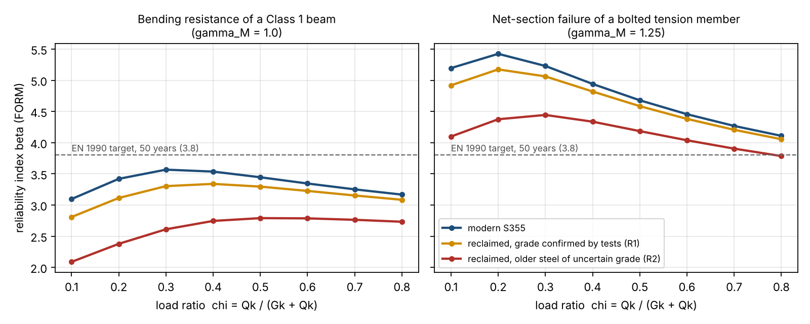

# Reliability of steel members in reclaimed steel

**How much reliability is lost when a steel member designed to the Eurocodes is made from reclaimed steel, and what
partial factor would restore it?** A small structural reliability study (November 2026): first-order reliability
(FORM) checked by importance sampling and Monte Carlo, applied to two failure modes and three steel scenarios, with a
calibration of the partial factor for equal reliability.



## The question

Steel from dismantled structures can often be reused, but it may be older, of uncertain grade and more variable than
modern steel. The Eurocode partial factors (γM0 = 1.0 for yielding, γM2 = 1.25 for fracture of a net section) were
set for modern steel. If a member is designed with these factors but its strength has a lower mean or a larger
scatter, its probability of failure rises. This study measures by how much, and finds the partial factor that would
give reclaimed steel the same reliability as modern steel.

## Method

1. **Design at the limit.** Each member is designed exactly to the Eurocode with the 6.10 combination
   (γG = 1.35, γQ = 1.5), for load ratios χ = Qk / (Gk + Qk) from 0.1 to 0.8:
   - bending of a Class 1 or 2 beam (EN 1993-1-1, 6.2.5): Wpl · fyk / γM0 = Ed;
   - net-section failure of a bolted tension member (EN 1993-1-1, 6.2.3): 0.9 · Anet · fuk / γM2 = Ed.
2. **Limit state.** g = KR · geo · R(f) − KE · (G + Q), with six independent basic variables:

   | Variable | Distribution | Mean | CoV | Source of the assumption |
   |---|---|---|---|---|
   | Resistance model uncertainty KR | lognormal | 1.0 | 0.05 | lower end of 1.0–1.15 and 0.05–0.10 in Nadolski et al. (2019) |
   | Section property (Wpl or Anet) | normal | 1.0 × nominal | 0.02 (0.04 in R2) | rolled sections 0.01–0.03 (ibid.) |
   | Yield strength fy / fyk (bending) | lognormal | 1.15 | 0.07 | JCSS-type model, μ/fyk 1.10–1.20, CoV 0.05–0.08 (ibid.) |
   | Tensile strength fu / fuk (net section) | lognormal | 1.10 | 0.05 | JCSS Probabilistic Model Code |
   | Permanent action G | normal | 1.0 × Gk | 0.10 | ibid. |
   | Imposed action Q, 50-year maximum | Gumbel | 0.6 × Qk | 0.35 | simplified 50-year model often used in calibration studies |
   | Load-effect model uncertainty KE | lognormal | 1.0 | 0.10 | ibid. |

3. **Steel scenarios.** Modern S355 as above, and two reclaimed-steel scenarios that are **illustrative assumptions,
   not measured data**:
   - **R1, grade confirmed by tests:** same means as modern steel, larger scatter (fy CoV 0.10, fu CoV 0.07);
   - **R2, older steel of uncertain grade:** lower means (fy/fyk 1.05, fu/fuk 1.05), larger scatter (fy CoV 0.12,
     fu CoV 0.10) and more geometric variation (CoV 0.04).
4. **Reliability.** FORM (Hasofer–Lind / Rackwitz–Fiessler in standard normal space, written from scratch in
   [`reliability/methods.py`](reliability/methods.py)) gives β, the design point and the sensitivity factors α. Every
   FORM result is checked by importance sampling around the design point (100,000 samples), and the least reliable
   case also by crude Monte Carlo (4 million samples).
5. **Calibration.** Over load ratios typical of steel buildings (χ = 0.2 to 0.6), find the γM that gives each
   reclaimed scenario the same mean β as modern steel, and the γM that keeps β ≥ 3.8, the EN 1990 target for
   reliability class RC2 and a 50-year reference period.

## Results

| Failure mode | Steel | Mean β (χ 0.2–0.6) | Min β | γM for the same reliability as modern steel | γM for β ≥ 3.8 |
|---|---|---|---|---|---|
| Bending (γM0 = 1.0) | modern S355 | 3.46 | 3.35 | — | 1.13 |
| | reclaimed R1 | 3.26 | 3.11 | 1.05 | 1.18 |
| | reclaimed R2 | 2.66 | 2.38 | 1.20 | 1.34 |
| Net section (γM2 = 1.25) | modern S355 | 4.95 | 4.46 | — | 1.05 |
| | reclaimed R1 | 4.80 | 4.38 | 1.29 | 1.07 |
| | reclaimed R2 | 4.28 | 4.04 | 1.46 | 1.17 |

1. **The scatter of strength costs reliability even when the mean is unchanged.** Raising the CoV of fy from 0.07
   to 0.10 (R1) lowers β for bending by about 0.2 and calls for γM0 ≈ 1.05 to restore it.
2. **A lower mean costs more.** R2 loses about 0.8 in β for bending; equal reliability needs γM0 ≈ 1.20.
   [Figure 2](figures/2_gamma_M0_vs_scatter.png) shows the required γM0 against the CoV of fy for two mean ratios:
   each 0.01 of CoV adds roughly 1 to 2.5% to γM0, and a mean ratio of 1.05 instead of 1.15 adds about 9 to 10%.
3. **The two failure modes behave differently.** Net-section failure keeps β above 3.8 in all three scenarios with the
   recommended γM2 = 1.25, because that factor already carries a large margin in this model; for bending, even modern
   steel falls below 3.8 with these probabilistic models, so "the same reliability as modern steel" is the more
   useful benchmark for reuse.
4. **What drives failure changes.** At χ = 0.4, the share of the yield strength in the variance at the design point
   (α²) rises from 0.11 for modern steel to 0.29 for R2, second only to the imposed load
   ([Figure 3](figures/3_sensitivity.png)). For reclaimed steel, testing the material is therefore worth as much as
   knowing the loads.
5. **The methods agree.** FORM and importance sampling differ by at most 0.06 in β over all 48 cases; at the least
   reliable point FORM gives 2.09, importance sampling 2.08 and crude Monte Carlo 2.08 (74,777 failures in 4 million).

## Limits of this study

- The reclaimed-steel statistics are assumptions chosen to show the method; real conclusions need test data on
  reclaimed steel (mean and scatter of fy and fu, by batch and age).
- Only two failure modes, without instability (buckling, lateral-torsional buckling) or ductility-dependent modes
  such as block tearing and rotation capacity, which need finite element analysis with a damage model.
- One load combination (6.10), one variable action and a simplified 50-year imposed-load model; no correlation
  between fy and fu (each limit state uses only one of them).
- Natural next steps: Bayesian updating of the strength model from a small number of tests (EN 1990, Annex D),
  the correlation of fy and fu, and limit states taken from finite element models.

## Run it

```
pip install -r requirements.txt
python3 -m unittest discover -s tests -v      # exact cases, distributions, FORM against sampling
python3 run.py                                # results/ and figures/
```

Results: [`results/beta_vs_chi.csv`](results/beta_vs_chi.csv), [`results/calibration.csv`](results/calibration.csv),
[`results/summary.json`](results/summary.json).

## References

- EN 1990:2002 Basis of structural design (Annex C, reliability; Annex D, design assisted by testing).
- EN 1993-1-1:2005 Design of steel structures, general rules (6.2.3 tension, 6.2.5 bending).
- Joint Committee on Structural Safety, *Probabilistic Model Code*, Part 3.02 Structural steel (2001).
- V. Nadolski, Á. Rózsás, M. Sýkora, "Calibrating Partial Factors – Methodology, Input Data and Case Study of Steel
  Structures", *Periodica Polytechnica Civil Engineering* 63(1), 222–242, 2019.
- M. Holický, *Reliability Analysis for Structural Design*, SUN MeDIA, 2009.

Saba Azadegan, 2026. MIT licence.
